[English](README.md) · **Français**

**Guides :** [Linux](https://fed1291.github.io/meshcore-proxy/GUIDE-linux.fr.html) ·
[Windows](https://fed1291.github.io/meshcore-proxy/GUIDE-windows.fr.html) ·
[mcproxy desk](https://fed1291.github.io/meshcore-proxy/desk/GUIDE.fr.html) ·
[Android](https://fed1291.github.io/meshcore-proxy/android/GUIDE.fr.html)

# mcproxy

> **Ça a l'air énorme, mais ça peut rester très simple.** Toutes les options ci-dessous sont facultatives. Vous
> pouvez utiliser mcproxy comme simple proxy : [installez-le](#télécharger), lancez une fois `mcproxy setup`,
> démarrez-le puis, dans l'app MeshCore, connectez-vous en Wi-Fi (TCP) à l'adresse IP de la machine où tourne le
> proxy, port **5000**. C'est tout.
>
> Sans service, il marche comme n'importe quel programme : lancez-le avec `mcproxy run`, laissez-le ouvert en
> arrière-plan, et il marche jusqu'à ce que vous le fermiez. Pour qu'il tourne toujours, installez-le comme
> [service sous Linux](#le-service-sous-linux) ou comme
> [tâche de fond sous Windows](#la-tâche-de-fond-sous-windows-comme-un-service).

Une radio compagnon MeshCore ne parle qu'à une app à la fois. **mcproxy** se place à côté de la radio, garde
cette unique connexion et laisse autant d'apps que vous voulez l'utiliser par votre réseau, comme si chacune
avait la radio pour elle seule. Et il retient ce que la radio ne peut pas garder : chaque message, chaque
noeud entendu, tout le mesh au fil du temps.


*Deux portes : les apps MeshCore habituelles passent par le port TCP 5000, comme avec un compagnon Wi-Fi ;
les apps faites pour le proxy, les pages web et les scripts passent par l'API de données, port HTTPS 5080.*

> **N'importe quelle app MeshCore s'y connecte comme à un noeud de votre réseau.**
> Indiquez dans l'app l'adresse IP de la machine du proxy, port **5000**, exactement comme pour un compagnon
> en Wi-Fi : les apps officielles MeshCore, meshcore-cli, l'intégration Home Assistant, tout ce qui parle le
> protocole compagnon MeshCore en TCP. Rien à installer dans l'app, pas de mode spécial. Plusieurs apps
> peuvent être connectées en même temps, et chacune voit la radio comme si elle était à elle.
> `mcproxy status` (et l'onglet État de la console) affiche l'adresse à utiliser. L'API de données du port
> 5080 est à part : elle sert aux apps faites pour le proxy (mcproxy desk, mcproxy pour Android), aux pages
> web et aux scripts.

La radio reste le chef : contacts, canaux et réglages radio sont chez elle, et mcproxy ne fait que relayer
les commandes. Autour, il garde l'historique pour lequel la radio n'a pas de place.

mcproxy est le programme principal et se suffit à lui-même : sa console montre la radio, les noeuds, le mesh,
l'historique et les logs, et a un chat pour lire et écrire ; les commandes `mcproxy` font le reste.
Les apps [mcproxy desk](desk/README.fr.md) et [Android](android/README.fr.md) sont des plus facultatifs qui
montrent les mêmes données dans une fenêtre ou sur un téléphone.

Je fais surtout des outils pour moi et je les partage tels quels. Par FED1291.

## L'essentiel

- **Téléphone, tablette et ordinateur en même temps.** Chaque réponse ne va qu'à l'app qui a demandé : deux
  apps ne mélangent jamais leurs listes de contacts, et chaque app voit chaque message.
- **Rien ne se perd.** Les messages sont stockés (chiffrés). Un téléphone en veille ou hors Wi-Fi reçoit à
  son retour ce qu'il a manqué (une app MeshCore : les 2 derniers jours par défaut, `mcproxy sync` le change ;
  les apps desk et Android : tout l'historique). La confirmation « remis » d'un message direct l'attend aussi,
  jusqu'à 24 heures.
- **Liste de contacts instantanée.** Le proxy garde les contacts de la radio : une app les reçoit tous d'un
  coup au lieu de les attendre par Bluetooth.
- **Ce que vous envoyez apparaît sur vos autres appareils.** Un message de canal envoyé du téléphone s'affiche
  aussi sur la tablette et l'ordinateur ; pour les messages directs, c'est au choix (`mcproxy mirror`).
- **Un observateur du mesh.** Chaque paquet entendu par la radio est enregistré : qui est là, par quel
  répéteur, avec quel signal. Au fil des jours, cela dessine le graphe du mesh.
- **Répéteurs suivis.** Choisissez des répéteurs, salons ou capteurs (`mcproxy track add <name>`) et le proxy
  leur demande régulièrement leur état et leur télémétrie.
- **Sauvegarde.** Contacts et canaux sont tenus à jour ; `mcproxy restore` les remet après un reflash.
- **Ça continue tout seul.** La liaison radio revient d'elle-même après une coupure, un débranchement ou un
  redémarrage.
- **Bluetooth, USB ou réseau.** Sous Linux comme sous Windows, la radio peut être appairée en Bluetooth,
  branchée en USB, ou jointe par Wi-Fi / Ethernet.
- **Français et anglais.** La langue du système est utilisée ; pour choisir : `mcproxy language fr`, ou `l` dans
  l'onglet État de la console. `mcproxy language new de` crée un fichier à traduire dans une autre langue. Le
  log, l'API et une partie des textes des commandes restent en anglais.

### Une console en direct

Lancez `mcproxy` et vous avez une vue de tout en plein écran, dans le terminal (par SSH aussi) :
état, noeuds, mesh, historique, logs et un chat.









### Une API de données

Tout ce que mcproxy enregistre, et presque tout ce qu'il sait faire, est ouvert à n'importe quel programme par
son API de données (HTTPS, port 5080). Les apps desk et Android n'utilisent rien d'autre et n'ont aucun
privilège : chacun peut en faire son propre client, une page web, un tableau de bord, un bot, une intégration
Home Assistant ou un script.

Ce qu'elle offre :

- **L'état en direct.** La liaison radio, le compagnon (batterie, bruit, contacts), les apps connectées, la file.
- **Les noeuds.** Chaque noeud entendu ou dans les contacts : annonces, signal, routes, état et télémétrie au
  fil du temps, voisins. Mettre un contact en favori, fixer son chemin, le suivre, se connecter à un répéteur
  ou un salon et lancer ses commandes.
- **Le mesh.** Chaque paquet entendu, décodé ; totaux par heure et par type ; le mesh en graphe de noeuds et
  de liens ; heures chargées ; paquets rejoués le long de leurs chemins ; traces.
- **Les messages.** Tout l'historique des canaux et des messages directs, par pages ; l'envoi, avec suivi de
  la remise et la garantie qu'un message ne part jamais deux fois ; renvois ; suppression.
- **Canaux et régions.** Ajouter ou retirer des canaux sur la radio, régler leur région, demander aux
  répéteurs proches quelles régions ils desservent.
- **Réglages et logs.** Les réglages du proxy et le log de son service.
- **Événements en direct.** Un seul flux Server-Sent Events pour les nouveaux paquets, messages, remises,
  noeuds et états : un client n'a jamais à interroger en boucle.

Comment elle se comporte :

- Du JSON en HTTPS, avec des champs nommés et les unités dans les noms (`snr_db`, `battery_mv`) ; les heures
  sont en secondes unix ; les longues listes sont paginées.
- **Stable :** dans `/api/v1`, des champs s'ajoutent, mais aucun n'est renommé ni retiré.
- `GET /api/v1` dit au client à quoi il parle et donne la liste des endpoints.
- Le proxy fait son propre certificat ; `mcproxy api` affiche son empreinte, que le client retient à la
  première connexion. Un jeton facultatif et une liste d'adresses autorisées limitent l'accès.
- Ouverte aux pages web (CORS), et `EventSource` marche directement dans un navigateur.

```bash
curl -k https://192.168.1.50:5080/api/v1/status
curl -k "https://192.168.1.50:5080/api/v1/messages?channel=Public&limit=20"
curl -kN https://192.168.1.50:5080/api/v1/events        # événements en direct
```

Chaque endpoint, champ, erreur et événement est dans [API.fr.md](API.fr.md) : commencez par le
[Démarrage rapide](API.fr.md#démarrage-rapide), puis la [liste des endpoints](API.fr.md#liste-des-endpoints).

## Télécharger

Depuis la page Releases :

| Fichier | Quoi | Pour |
|---|---|---|
| `mcproxy-<version>-linux-arm64.tar.gz` | mcproxy pour Linux | Linux ARM 64 bits avec systemd : Raspberry Pi 3 / 4 / 5 / Zero 2 avec un OS 64 bits, autres cartes ARM64 |
| `mcproxy-<version>-linux-x64.tar.gz` | mcproxy pour Linux | Linux x86 64 bits avec systemd |
| `mcproxy-<version>-windows-x64.zip` | mcproxy pour Windows | Windows 10 / 11, 64 bits ; pour une radio Bluetooth, Bluetooth 4.0 ou plus récent (intégré ou clé) |
| `mcproxy-desk-<version>-windows-x64.zip` | [mcproxy desk](desk/README.fr.md) pour Windows | Windows 10 / 11, 64 bits |
| `mcproxy-desk-<version>-linux-x64.tar.gz` | [mcproxy desk](desk/README.fr.md) pour Linux | Linux x86 64 bits |
| `mcproxy-android-<version>.zip` | [mcproxy pour Android](android/README.fr.md) (le `.apk`) | Android 10 ou plus récent |

**La même version partout :** utilisez toujours mcproxy desk et mcproxy pour Android avec le mcproxy de la même
version. Quand vous mettez l'un à jour, mettez aussi les autres à jour. Cela ne concerne pas les apps MeshCore
habituelles.

`SHA256SUMS.txt`, à côté, permet de vérifier un téléchargement (`sha256sum -c SHA256SUMS.txt --ignore-missing`).

Chaque téléchargement a son propre `GUIDE.html` (en anglais) : ouvrez-le dans un navigateur pour tout le reste
(installation, chaque commande, chaque écran, dépannage). Les guides en français sont [en ligne](#pour-aller-plus-loin).

### Linux (Raspberry Pi, autres cartes ARM64, PC x86)

Copiez le `.tar.gz` sur la machine et décompressez-le dans un dossier de votre utilisateur, par ex. `~/mcproxy`.
Déconnectez d'abord votre téléphone de la radio : elle n'accepte qu'une connexion à la fois. Puis :

```bash
tar xzf mcproxy-*-linux-arm64.tar.gz && mv mcproxy-*-linux-arm64 ~/mcproxy   # sur un PC x86 : linux-x64
bash ~/mcproxy/deploy/install.sh   # une fois : config, commande mcproxy, accès Bluetooth et USB, service
mcproxy setup                      # trouve la radio (USB, Bluetooth), l'appaire si besoin, démarre le service
mcproxy status                     # doit afficher la radio connectée et l'adresse pour les apps
```

Si `install.sh` dit vous avoir ajouté à un groupe, fermez votre session et rouvrez-la d'abord. Pour une radio sur
le réseau : `mcproxy setup --tcp 192.168.1.60`. Nouvelle radio, nouvel adaptateur ou nouvelle antenne plus tard ?
Relancez `mcproxy setup`.

#### Le service sous Linux

`install.sh` enregistre mcproxy comme service systemd, lancé à chaque démarrage de la machine, avec l'utilisateur à
qui appartient le dossier ; `mcproxy setup` le démarre. Ensuite :

```bash
systemctl status mcproxy            # tourne-t-il ?
sudo systemctl start mcproxy        # démarrer
sudo systemctl stop mcproxy         # arrêter (par ex. pour utiliser la radio directement du téléphone)
sudo systemctl restart mcproxy      # redémarrer (après un changement de config ou une mise à jour)
mcproxy logs -f                     # son log en direct (Ctrl+C arrête l'affichage)
```

Pour qu'il démarre avec la machine ou non, sans rien supprimer :

```bash
sudo systemctl disable --now mcproxy   # l'arrêter, et ne plus le lancer au démarrage
sudo systemctl enable --now mcproxy    # le démarrer, et de nouveau à chaque démarrage
```

Pour supprimer le service (le dossier reste) :

```bash
sudo systemctl disable --now mcproxy
sudo rm /etc/systemd/system/mcproxy.service
sudo systemctl daemon-reload
```

### Windows

Décompressez le `.zip` et placez son dossier là où votre utilisateur peut écrire, par ex. `C:\mcproxy` (pas dans
Program Files : config, base de données et logs sont à côté du programme). Branchez la radio ou, en Bluetooth,
déconnectez d'abord votre téléphone : elle n'accepte qu'une connexion à la fois. Ouvrez PowerShell dans ce
dossier :

```powershell
.\mcproxy setup     # trouve la radio (USB, puis Bluetooth), l'appaire si besoin
.\mcproxy run       # tourne tant que la fenêtre est ouverte (Ctrl+C l'arrête)
.\mcproxy status    # dans une deuxième fenêtre
```

`.\mcproxy setup --ble` ne cherche qu'en Bluetooth. Rien à installer et pas d'adaptateur à choisir : Windows donne
aux programmes son adaptateur par défaut. L'appairage appartient au compte Windows qui a lancé setup : faites
tourner mcproxy avec ce compte. `.\mcproxy unpair` supprime l'appairage.

La première fois, autorisez mcproxy sur les réseaux privés quand le pare-feu Windows le demande.

#### La tâche de fond sous Windows (comme un service)

Au lieu de garder une fenêtre ouverte, Windows peut lancer mcproxy à chaque démarrage du PC, sans fenêtre et avant
toute ouverture de session. Faites d'abord `.\mcproxy setup`, et arrêtez mcproxy s'il tourne (Ctrl+C dans sa
fenêtre). Ouvrez PowerShell avec **Exécuter en tant qu'administrateur**, avec le compte Windows qui a lancé setup, et
collez tout le bloc (changez la première ligne si votre dossier est ailleurs) :

```powershell
cd C:\mcproxy
$exe = (Resolve-Path .\mcproxy.exe).Path
$action = New-ScheduledTaskAction -Execute $exe -Argument run -WorkingDirectory (Split-Path $exe)
$trigger = New-ScheduledTaskTrigger -AtStartup
$user = New-ScheduledTaskPrincipal -UserId "$env:USERDOMAIN\$env:USERNAME" -LogonType S4U -RunLevel Limited
$settings = New-ScheduledTaskSettingsSet -ExecutionTimeLimit ([TimeSpan]::Zero) -AllowStartIfOnBatteries -DontStopIfGoingOnBatteries -StartWhenAvailable -RestartCount 999 -RestartInterval (New-TimeSpan -Minutes 1)
Register-ScheduledTask -TaskName mcproxy -Action $action -Trigger $trigger -Principal $user -Settings $settings
New-NetFirewallRule -DisplayName mcproxy -Direction Inbound -Program $exe -Action Allow -Profile Private
Start-ScheduledTask mcproxy
```

La règle de pare-feu laisse les apps des autres appareils joindre le proxy, sur les réseaux déclarés privés. Un PC en
veille arrête le proxy : réglez la mise en veille sur Jamais sur secteur. Ensuite, dans PowerShell en administrateur :

```powershell
Get-ScheduledTask mcproxy                                 # tourne-t-elle ? (State : Running)
Start-ScheduledTask mcproxy                               # démarrer
Stop-ScheduledTask mcproxy                                # arrêter (avant setup ou une mise à jour)
Stop-ScheduledTask mcproxy; Start-ScheduledTask mcproxy   # redémarrer (après un changement de config)
```

Pour qu'elle démarre avec le PC ou non, sans rien supprimer :

```powershell
Stop-ScheduledTask mcproxy; Disable-ScheduledTask mcproxy    # l'arrêter, et ne plus la lancer avec le PC
Enable-ScheduledTask mcproxy; Start-ScheduledTask mcproxy    # la démarrer, et de nouveau avec le PC
```

Pour supprimer la tâche et sa règle de pare-feu (le dossier reste) :

```powershell
cd C:\mcproxy
Stop-ScheduledTask mcproxy -ErrorAction SilentlyContinue
Unregister-ScheduledTask mcproxy -Confirm:$false -ErrorAction SilentlyContinue
Get-NetFirewallApplicationFilter -Program (Resolve-Path .\mcproxy.exe).Path | Get-NetFirewallRule | Remove-NetFirewallRule
```

## Connecter vos apps

| App | Se connecte à |
|---|---|
| N'importe quelle app MeshCore (apps officielles, meshcore-cli, Home Assistant…) | TCP, l'adresse de la machine du proxy, port 5000 (par ex. `192.168.1.50`, port `5000`), comme un compagnon sur le réseau |
| mcproxy desk, mcproxy pour Android (facultatif) | L'API de données : `mcproxy api` sur la machine du proxy affiche l'adresse (par ex. `https://192.168.1.50:5080`) et l'empreinte du certificat |

Les apps MeshCore n'ont besoin de rien de spécial : pour elles, le proxy ressemble à la radio. L'API de données du
port 5080 est à part : elle sert aux apps faites pour le proxy (mcproxy desk, mcproxy pour Android), aux pages web
et aux scripts.

## Apps facultatives

Les apps MeshCore marchent telles quelles. Deux apps facultatives sont faites pour ce que le proxy enregistre
(utilisez-les toujours avec le mcproxy de la même version) :

- **[mcproxy desk](desk/README.fr.md)**, pour Windows et Linux : chaque noeud, le mesh en chiffres, autour de
  vous ou en relief 3D, des fenêtres de chat, les événements et le log du proxy en direct.
- **[mcproxy pour Android](android/README.fr.md)** : chats, contacts, régions et une console pour vos répéteurs,
  avec la radio qui reste connectée au proxy pendant que le téléphone va et vient.

[](desk/README.fr.md)

## Pour aller plus loin

- MeshCore lui-même : [docs.meshcore.io](https://docs.meshcore.io)
- L'API de données : [API.fr.md](API.fr.md)
- Les guides : [Linux](https://fed1291.github.io/meshcore-proxy/GUIDE-linux.fr.html),
  [Windows](https://fed1291.github.io/meshcore-proxy/GUIDE-windows.fr.html),
  [desk](https://fed1291.github.io/meshcore-proxy/desk/GUIDE.fr.html),
  [Android](https://fed1291.github.io/meshcore-proxy/android/GUIDE.fr.html)
