**English** · [Français](README.fr.md)

**Guides:** [Linux](https://fed1291.github.io/meshcore-proxy/GUIDE-linux.html) ·
[Windows](https://fed1291.github.io/meshcore-proxy/GUIDE-windows.html) ·
[mcproxy desk](https://fed1291.github.io/meshcore-proxy/desk/GUIDE.html) ·
[Android](https://fed1291.github.io/meshcore-proxy/android/GUIDE.html)

# mcproxy

> **It looks like a lot, but it can be very simple.** All the options below are optional. You can use mcproxy as
> just a basic proxy: [install it](#get-it), run `mcproxy setup` once, start it, then, in the MeshCore app, connect
> by Wi-Fi (TCP) to the IP address of the machine where the proxy runs, port **5000**. That's all.
>
> Not set up as a service, it works like any regular program: start it with `mcproxy run`, leave it open in the
> background, and it works until you close it. To have it always on, set it up as a
> [service on Linux](#the-service-on-linux) or a
> [background task on Windows](#the-background-task-on-windows-like-a-service).

A MeshCore companion radio talks to one app at a time. **mcproxy** sits next to the radio, holds that one
connection, and lets any number of apps use it over your network, as if each had the radio to itself.
And it remembers what the radio can't: every message, every node heard, the whole mesh over time.


*Two doors: the regular MeshCore apps use TCP port 5000, as with a Wi-Fi companion; the apps built around
the proxy, web pages and scripts use the data API on HTTPS port 5080.*

> **Any MeshCore app connects to it like to a node on your network.**
> Point the app at the proxy machine's IP address, port **5000**, exactly as you would connect to a
> companion with Wi-Fi: the official MeshCore apps, meshcore-cli, the Home Assistant integration,
> anything that speaks the MeshCore companion protocol over TCP. Nothing to install in the app, no
> special mode. Several apps can be connected at once, and each sees the radio as if it were its own.
> `mcproxy status` (and the console's Status tab) shows the address to use. The data API on port 5080
> is separate: it serves the apps built around the proxy (mcproxy desk, mcproxy for Android), web pages
> and scripts.

The radio stays the boss: contacts, channels and radio settings live on it, and mcproxy only relays the
commands. Around that, it keeps the history the radio has no room for.

mcproxy is the main program and works on its own: its console shows the radio, the nodes, the mesh, the
history and the logs, and has a chat to read and write messages; the `mcproxy` commands do the rest.
The [mcproxy desk](desk/README.md) and [Android](android/README.md) apps are optional extras that show
the same data in a window or on a phone.

I mostly make tools for myself and share them as they are. By FED1291.

## Top features

- **Phone, tablet and desktop at once.** Each reply goes only to the app that asked, so two apps never mix
  their contact lists, and every app sees every message.
- **Nothing missed.** Messages are stored (encrypted). A phone that was asleep or off Wi-Fi gets what it
  missed when it comes back (a MeshCore app: the last 2 days by default, `mcproxy sync` changes it; the
  desk and Android apps: the whole history). The "delivered" confirmation of a direct message waits
  for it too, up to 24 hours.
- **Instant contact list.** The proxy keeps the radio's contacts, so an app gets all of them at once
  instead of waiting for them over Bluetooth.
- **What you send shows up on your other devices.** A channel message sent from the phone appears on the
  tablet and the desktop too; for direct messages it's a switch (`mcproxy mirror`).
- **A mesh observer.** Every packet the radio hears is recorded: who is out there, through which repeater,
  at what signal. Over days it builds the mesh as a graph.
- **Tracked repeaters.** Pick repeaters, rooms or sensors (`mcproxy track add <name>`) and the proxy asks
  them regularly for their status and telemetry.
- **Backup.** Contacts and channels are kept up to date; `mcproxy restore` puts them back after a reflash.
- **It just keeps going.** The radio link comes back by itself after a drop, an unplug or a reboot.
- **Bluetooth, USB or network.** On Linux and on Windows, the radio can be paired over Bluetooth,
  plugged in by USB, or reached over Wi-Fi / Ethernet.
- **English and French.** The system's language is used, or choose with `mcproxy language fr`, or `l` on the
  console's Status tab. `mcproxy language new de` makes a file to translate into another language. The log,
  the API and some command output stay in English.

### A live console

Run `mcproxy` and you get a full-screen view of everything, right in the terminal (over SSH too):
status, nodes, mesh, history, logs and a chat.









### A data API

Everything mcproxy records, and most of what it can do, is open to any program through its data API
(HTTPS, port 5080). The desk and Android apps use nothing else, and get nothing special: anyone can
build their own client on it, a web page, a dashboard, a bot, a Home Assistant integration or a script.

What it offers:

- **Live state.** The radio link, the companion (battery, noise, contacts), connected apps, the queue.
- **Nodes.** Every node heard or in the contact list: adverts, signal, routes, status and telemetry
  over time, neighbours. Star a contact, set its path, track it, log in to a repeater or room and run
  its commands.
- **The mesh.** Every packet heard, decoded; totals per hour and type; the mesh as a graph of nodes and
  links; busy hours; packets replayed along their paths; traces.
- **Messages.** The whole history of channels and direct messages, paged; sending, with delivery
  tracking and a guarantee that one message never goes out twice; resends; deleting.
- **Channels and regions.** Add or remove channels on the radio, set their region, ask nearby repeaters
  which regions they serve.
- **Settings and logs.** The proxy's own switches and its service log.
- **Live events.** One Server-Sent Events stream for new packets, messages, delivery changes, nodes and
  status, so a client never has to poll.

How it behaves:

- JSON over HTTPS, with named fields and units in the names (`snr_db`, `battery_mv`); times are unix
  seconds; long lists are paged.
- **Stable:** within `/api/v1`, fields are only ever added, never renamed or removed.
- `GET /api/v1` tells a client what it's talking to and lists every endpoint.
- The proxy makes its own certificate; `mcproxy api` shows its fingerprint, for the client to pin on
  first use. An optional token, and an allowed-address list, limit who gets in.
- Open to web pages (CORS), and `EventSource` works straight from a browser.

```bash
curl -k https://192.168.1.50:5080/api/v1/status
curl -k "https://192.168.1.50:5080/api/v1/messages?channel=Public&limit=20"
curl -kN https://192.168.1.50:5080/api/v1/events        # live events, as they happen
```

Every endpoint, field, error and event is in [API.md](API.md): start with its
[Quick start](API.md#quick-start), then the [endpoint index](API.md#endpoint-index).

## Get it

From the Releases page:

| Download | What | Runs on |
|---|---|---|
| `mcproxy-<version>-linux-arm64.tar.gz` | mcproxy for Linux | 64-bit ARM Linux with systemd: Raspberry Pi 3 / 4 / 5 / Zero 2 with a 64-bit OS, other ARM64 boards |
| `mcproxy-<version>-linux-x64.tar.gz` | mcproxy for Linux | 64-bit x86 Linux with systemd |
| `mcproxy-<version>-windows-x64.zip` | mcproxy for Windows | Windows 10 / 11, 64-bit; for a Bluetooth radio, Bluetooth 4.0 or newer (built in or a dongle) |
| `mcproxy-desk-<version>-windows-x64.zip` | [mcproxy desk](desk/README.md) for Windows | Windows 10 / 11, 64-bit |
| `mcproxy-desk-<version>-linux-x64.tar.gz` | [mcproxy desk](desk/README.md) for Linux | 64-bit x86 Linux |
| `mcproxy-android-<version>.zip` | [mcproxy for Android](android/README.md) (the `.apk`) | Android 10 or newer |

**Use the same version everywhere:** mcproxy desk and mcproxy for Android should always be used with the
mcproxy of the same version. When you update one, update the others too. This doesn't apply to
the regular MeshCore apps.

`SHA256SUMS.txt` next to them lets you check a download (`sha256sum -c SHA256SUMS.txt --ignore-missing`).

Each download has its own `GUIDE.html`: open it in a browser for everything (install, every command,
every screen, troubleshooting).

### Linux (Raspberry Pi, other ARM64 boards, x86 PCs)

Copy the `.tar.gz` to the machine and unpack it into a folder your user owns, e.g. `~/mcproxy`.
Disconnect your phone from the radio first: it takes one connection at a time. Then:

```bash
tar xzf mcproxy-*-linux-arm64.tar.gz && mv mcproxy-*-linux-arm64 ~/mcproxy   # on an x86 PC: linux-x64
bash ~/mcproxy/deploy/install.sh   # once: config, the mcproxy command, access to Bluetooth and USB, the service
mcproxy setup                      # finds the radio (USB, Bluetooth), pairs if needed, starts the service
mcproxy status                     # should show "radio connected" and the address the apps use
```

If `install.sh` says it added you to a group, log out and back in first. For a radio on the network:
`mcproxy setup --tcp 192.168.1.60`. New radio, adapter or antenna later on? Run `mcproxy setup` again.

#### The service on Linux

`install.sh` registers mcproxy as a systemd service that starts at every boot, as the user who owns the
folder; `mcproxy setup` starts it. Then:

```bash
systemctl status mcproxy            # is it running?
sudo systemctl start mcproxy        # start
sudo systemctl stop mcproxy         # stop (for example to use the radio directly from the phone)
sudo systemctl restart mcproxy      # restart (after a config change or an update)
mcproxy logs -f                     # its log, live (Ctrl+C stops watching)
```

To start it at boot or not, without removing anything:

```bash
sudo systemctl disable --now mcproxy   # stop it, and don't start it at boot any more
sudo systemctl enable --now mcproxy    # start it, and at every boot again
```

To remove the service (the folder stays):

```bash
sudo systemctl disable --now mcproxy
sudo rm /etc/systemd/system/mcproxy.service
sudo systemctl daemon-reload
```

### Windows

Unzip the `.zip` and put its folder somewhere your user can write to, e.g. `C:\mcproxy` (not under
Program Files: config, database and logs live next to the program). Plug in the radio, or for Bluetooth
disconnect your phone from it first: it takes one connection at a time. Open PowerShell in that folder:

```powershell
.\mcproxy setup     # finds the radio (USB, then Bluetooth), pairs if needed
.\mcproxy run       # runs while the window stays open (Ctrl+C stops it)
.\mcproxy status    # in a second window
```

`.\mcproxy setup --ble` looks on Bluetooth only. Nothing to install and no adapter to choose: Windows gives
programs its default one. The pairing belongs to the Windows account that ran setup, so run mcproxy as
that account. `.\mcproxy unpair` removes the pairing.

The first time, allow mcproxy on private networks when Windows Firewall asks.

#### The background task on Windows (like a service)

Instead of keeping a window open, Windows can start mcproxy at every start of the PC, with no window and
before anyone logs in. Run `.\mcproxy setup` first, and stop mcproxy if it runs (Ctrl+C in its window).
Open PowerShell with **Run as administrator**, with the same Windows account that ran setup, and paste the
whole block (change the first line if your folder is elsewhere):

```powershell
cd C:\mcproxy
$exe = (Resolve-Path .\mcproxy.exe).Path
$action = New-ScheduledTaskAction -Execute $exe -Argument run -WorkingDirectory (Split-Path $exe)
$trigger = New-ScheduledTaskTrigger -AtStartup
$user = New-ScheduledTaskPrincipal -UserId "$env:USERDOMAIN\$env:USERNAME" -LogonType S4U -RunLevel Limited
$settings = New-ScheduledTaskSettingsSet -ExecutionTimeLimit ([TimeSpan]::Zero) -AllowStartIfOnBatteries -DontStopIfGoingOnBatteries -StartWhenAvailable -RestartCount 999 -RestartInterval (New-TimeSpan -Minutes 1)
Register-ScheduledTask -TaskName mcproxy -Action $action -Trigger $trigger -Principal $user -Settings $settings
New-NetFirewallRule -DisplayName mcproxy -Direction Inbound -Program $exe -Action Allow -Profile Private
Start-ScheduledTask mcproxy
```

The firewall rule lets apps on other devices reach the proxy, on networks set as private. A PC that sleeps
stops the proxy: set sleep to Never when plugged in. From then on, in PowerShell as administrator:

```powershell
Get-ScheduledTask mcproxy                                 # is it running? (State: Running)
Start-ScheduledTask mcproxy                               # start
Stop-ScheduledTask mcproxy                                # stop (before setup or an update)
Stop-ScheduledTask mcproxy; Start-ScheduledTask mcproxy   # restart (after a config change)
```

To start it with the PC or not, without removing anything:

```powershell
Stop-ScheduledTask mcproxy; Disable-ScheduledTask mcproxy    # stop it, and don't start it with the PC any more
Enable-ScheduledTask mcproxy; Start-ScheduledTask mcproxy    # start it, and with the PC again
```

To remove the task and its firewall rule (the folder stays):

```powershell
cd C:\mcproxy
Stop-ScheduledTask mcproxy -ErrorAction SilentlyContinue
Unregister-ScheduledTask mcproxy -Confirm:$false -ErrorAction SilentlyContinue
Get-NetFirewallApplicationFilter -Program (Resolve-Path .\mcproxy.exe).Path | Get-NetFirewallRule | Remove-NetFirewallRule
```

## Connect your apps

| App | Connect to |
|---|---|
| Any MeshCore app (official apps, meshcore-cli, Home Assistant…) | TCP, the proxy machine's address, port 5000 (e.g. `192.168.1.50`, port `5000`), like a companion on the network |
| mcproxy desk, mcproxy for Android (optional) | The data API: `mcproxy api` on the proxy machine shows the address (e.g. `https://192.168.1.50:5080`) and the certificate fingerprint |

The MeshCore apps need nothing special: to them, the proxy looks like the radio. The data API on port
5080 is separate: it serves the apps built around the proxy (mcproxy desk, mcproxy for Android), web
pages and scripts.

## Optional apps

The MeshCore apps work as they are. Two optional apps are made for what the proxy records
(always use them with the mcproxy of the same version):

- **[mcproxy desk](desk/README.md)**, for Windows and Linux: every node, the mesh in numbers, around you
  or on the 3D terrain, chat windows, the proxy's live events and log.
- **[mcproxy for Android](android/README.md)**: chats, contacts, regions and a console for your
  repeaters, with the radio staying connected to the proxy while the phone comes and goes.

[](desk/README.md)

## More

- MeshCore itself: [docs.meshcore.io](https://docs.meshcore.io)
- The data API: [API.md](API.md)
- The guides: [Linux](https://fed1291.github.io/meshcore-proxy/GUIDE-linux.html),
  [Windows](https://fed1291.github.io/meshcore-proxy/GUIDE-windows.html),
  [desk](https://fed1291.github.io/meshcore-proxy/desk/GUIDE.html),
  [Android](https://fed1291.github.io/meshcore-proxy/android/GUIDE.html)
