[English](README.md) · **Français**

**Guide :** [mcproxy pour Android](https://fed1291.github.io/meshcore-proxy/android/GUIDE.fr.html)

# mcproxy pour Android

L'app téléphone de [mcproxy](../README.fr.md). Elle se connecte à l'API de données du proxy (HTTPS, port 5080), pas à
la radio : elle montre ce que le proxy relaie et stocke, et envoie par le proxy. La radio reste connectée au proxy
pendant que le téléphone va et vient.

Elle est facultative : mcproxy se suffit à lui-même, avec sa console et ses commandes. L'app Android apporte les mêmes
données et les chats sur votre téléphone.

## Ce qu'elle fait

- **Les chats.** Canaux (public, hashtag, privés) et messages directs, en direct, avec réponses, liens et état de
  remise.
- **Pas de double envoi.** Chaque message a son propre id. Après une erreur réseau, l'app répète la demande avec le
  même id, et le proxy n'envoie chaque id qu'une fois.
- **Les contacts.** Chaque noeud que le proxy connaît : recherche, filtres, une fiche par contact avec sa route et sa clé.
- **Les stats.** Le mesh autour de votre radio sur 1 heure à 30 jours. Aperçu : paquets entendus, noeuds, messages, ce
  que le mesh transporte, la batterie, le bruit et la température de votre compagnon, les répéteurs par lesquels vous
  entendez. Mesh : paquets par heure et par type, signal, messages par heure, une journée type, à quel rythme les
  répéteurs s'annoncent.
- **Les régions.** Voir et régler la région de chaque canal, et demander aux répéteurs proches quelles régions ils desservent.
- **La console des noeuds.** Se connecter à des répéteurs, capteurs et salons, envoyer des commandes, lire leurs réponses.
- **Les notifications.** Par chat : tous les messages, les mentions seulement, ou aucune. En option, app fermée aussi.
- **À l'image de votre téléphone.** Material You sur la plupart des téléphones, One UI sur Samsung ; clair et sombre suivent le téléphone.
- **Français et anglais.** Elle suit la langue du téléphone ; à partir d'Android 13, l'app peut avoir la sienne.

## Il faut

- **mcproxy** de la même version que l'app, avec son API de données active (par défaut). Quand vous mettez l'un à jour,
  mettez aussi l'autre à jour.
- **Un téléphone** avec Android 10 ou plus récent, sur le même réseau que le proxy (ou qui le joint par un VPN).

## Se connecter

1. Sur la machine du proxy, `mcproxy api` affiche l'adresse (par ex. `https://192.168.1.50:5080/api/v1`) et
   l'empreinte du certificat.
2. Dans l'app, entrez l'adresse, par ex. `https://192.168.1.50:5080`, et le jeton seulement si le proxy en définit un.
   Touchez Connecter.
3. La première fois, l'app demande « Est-ce le bon proxy ? » avec l'empreinte du certificat. Comparez-la avec celle de
   l'étape 1, puis **Approuver**. L'app la retient.

Si l'app dit plus tard que le certificat du proxy a changé et que vous n'avez pas réinstallé le proxy, un autre appareil
répond à cette adresse.

Le guide ([en français, en ligne](https://fed1291.github.io/meshcore-proxy/android/GUIDE.fr.html) ; en anglais dans le
téléchargement, `GUIDE.html`) couvre chaque écran.
