**English** · [Français](README.fr.md)

**Guide:** [mcproxy for Android](https://fed1291.github.io/meshcore-proxy/android/GUIDE.html)

# mcproxy for Android

The phone app for [mcproxy](../README.md). It connects to the proxy's data API (HTTPS, port 5080), not to
the radio: it shows what the proxy relays and stores, and sends through the proxy. The radio stays
connected to the proxy while the phone comes and goes.

It's optional: mcproxy works on its own, with its console and commands. The Android app brings the
same data and the chats to your phone.

## What it does

- **Chats.** Channels (public, hashtag, private) and direct messages, live, with replies, links and
  delivery status.
- **No duplicate sends.** Each message has its own id. After a network error the app repeats the
  request with the same id, and the proxy sends each id once.
- **Contacts.** Every node the proxy knows: search, filters, a card per contact with its route and key.
- **Stats.** The mesh around your radio over 1 hour to 30 days. Overview: packets heard, nodes,
  messages, what the mesh carries, your companion's battery, noise and temperature, the repeaters you
  hear through. Mesh: packets per hour and type, signal, messages per hour, a typical day, how often
  repeaters advert.
- **Regions.** See and set the region of each channel, and ask the repeaters near you which regions they serve.
- **Node console.** Log in to repeaters, sensors and room servers, send commands, read what they report.
- **Notifications.** Per chat: all messages, mentions only, or none. Optionally while the app is closed.
- **Looks like your phone.** Material You on most phones, One UI on Samsung; light and dark follow the phone.
- **English and French.** It follows the phone's language; on Android 13 and newer the app can have its own.

## Requirements

- **mcproxy** of the same version as the app, running with its data API on (the default). When you update
  one, update the other too.
- **A phone** with Android 10 or newer, on the same network as the proxy (or reaching it through a VPN).

## Connect

1. On the proxy machine, `mcproxy api` shows the address (e.g. `https://192.168.1.50:5080/api/v1`) and
   the certificate fingerprint.
2. In the app, enter the address, e.g. `https://192.168.1.50:5080`, and the token only if the proxy
   sets one. Tap Connect.
3. The first time, the app asks "Is this your proxy?" with the certificate fingerprint. Compare it with
   the one from step 1, then **Trust and connect**. The app remembers it.

If the app later says the proxy's certificate changed and you didn't reinstall the proxy, another device
is answering at that address.

`GUIDE.html`, in the download and [online](https://fed1291.github.io/meshcore-proxy/android/GUIDE.html), covers
every screen.
