[English](README.md) · **Français**

**Guide :** [mcproxy desk](https://fed1291.github.io/meshcore-proxy/desk/GUIDE.fr.html)

# mcproxy desk

L'app de bureau de [mcproxy](../README.fr.md). Elle se connecte à l'API de données du proxy par votre réseau et
montre tout ce qu'il enregistre : l'état de la radio, chaque noeud entendu, le mesh en graphe, les canaux, et des
fenêtres de chat pour écrire. Elle ne parle qu'au proxy, jamais directement à la radio.

Elle est facultative : mcproxy se suffit à lui-même, avec sa console et ses commandes. L'app desk montre les mêmes
données dans une fenêtre, depuis n'importe quel ordinateur de votre réseau.

## Ce qu'elle montre

- **Un aperçu en direct.** La batterie, le bruit et la liaison du compagnon, les apps connectées, le stockage et la file du proxy.
- **Chaque noeud.** Une page par noeud : signal, annonces, routes, et pour un répéteur ses stats, sa santé et ses voisins.
- **Le mesh.** Paquets par heure et par type, heures les plus chargées, qui vous apporte des paquets, à quel rythme
  les répéteurs s'annoncent.
- **Explorer.** Le mesh autour de vous, ou en relief 3D, avec les paquets rejoués le long de leurs chemins.
- **Les chats.** Fenêtres de canaux et de messages directs, avec réponses, coches de remise et régions.
- **Live et Journal.** Le flux d'événements décodés du proxy, et le log de son service.
- **Français et anglais.** Elle suit la langue du système ; Connexion et réglages > Langue la change aussitôt.
  « Ajouter une langue », au même endroit, crée un fichier à traduire dans une autre.

Chaque réglage dit où il est gardé : sur la radio (le même dans toutes les apps, les apps MeshCore aussi),
sur le proxy (pour toutes les apps connectées par lui), ou dans cette app seulement.

## Il faut

- **mcproxy** de la même version que l'app, avec son API de données active (par défaut, port 5080).
  Quand vous mettez l'un à jour, mettez aussi l'autre à jour.
- **Un ordinateur** sur le même réseau : Windows 10 / 11 64 bits, ou Linux x86 64 bits. La vue en relief utilise la carte graphique s'il y en a une.
- **Internet** seulement pour la vue en relief d'Explorer (tuiles d'altitude, téléchargées une fois et gardées).

## Se connecter

1. Sur la machine du proxy, `mcproxy api` affiche l'adresse (par ex. `https://192.168.1.50:5080/api/v1`) et
   l'empreinte du certificat.
2. Lancez l'app : elle s'ouvre sur sa page **Connexion et réglages**. Dans la carte Proxy, entrez l'adresse, par ex.
   `https://192.168.1.50:5080`, et le jeton seulement si le proxy en définit un. Puis Connecter.
3. La première fois, l'app affiche l'empreinte du certificat du proxy. Comparez-la avec celle de l'étape 1, puis
   **Approuver**. L'app la retient pour cette adresse.

Si l'app dit plus tard que le certificat du proxy a changé, elle montre la nouvelle empreinte et celle approuvée
avant. Choisissez **Approuver le nouveau** seulement après avoir réinstallé le proxy ou renouvelé son certificat ;
sinon, un autre appareil répond à cette adresse : Annuler.

Le guide ([en français, en ligne](https://fed1291.github.io/meshcore-proxy/desk/GUIDE.fr.html) ; en anglais dans le
téléchargement, `GUIDE.html`) parcourt chaque page de l'app.
