**English** · [Français](README.fr.md)

**Guide:** [mcproxy desk](https://fed1291.github.io/meshcore-proxy/desk/GUIDE.html)

# mcproxy desk

The desktop app for [mcproxy](../README.md). It connects to the proxy's data API over your network and
shows everything the proxy records: the radio's state, every node heard, the mesh as a graph, the
channels, and chat windows to write in. It talks only to the proxy, never to the radio directly.

It's optional: mcproxy works on its own, with its console and commands. The desk app shows the same
data in a window, from any computer on your network.

## What it shows

- **Live overview.** The companion's battery, noise and link, the apps connected, the proxy's store and queue.
- **Every node.** A page per node: signal, adverts, routes, and for a repeater its stats, health and neighbours.
- **The mesh.** Packets per hour and type, the busiest hours, who brings packets to you, how often
  repeaters advert.
- **Explore.** The mesh around you, or on the 3D terrain, with packets replayed along their paths.
- **Chats.** Channel and direct-message windows, with replies, delivery ticks and regions.
- **Live and logs.** The proxy's decoded event stream, and its service log.
- **English and French.** It follows the system's language; Connection & settings > Language changes it at
  once. "Add a language" there makes a file to translate into another one.

Every setting says where it is kept: on the radio (the same in every app, the MeshCore apps too),
on the proxy (for every app connected through it), or in this app only.

## Requirements

- **mcproxy** of the same version as the app, running with its data API on (the default, port 5080).
  When you update one, update the other too.
- **A computer** on the same network: Windows 10 / 11 64-bit, or 64-bit x86 Linux. The terrain view uses the GPU when there is one.
- **Internet** only for Explore's terrain view (elevation tiles, downloaded once and kept).

## Connect

1. On the proxy machine, `mcproxy api` shows the address (e.g. `https://192.168.1.50:5080/api/v1`) and
   the certificate fingerprint.
2. Start the app: it opens on its **Connection & settings** page. In the Proxy card, enter the address,
   e.g. `https://192.168.1.50:5080`, and the token only if the proxy sets one. Then Connect.
3. The first time, the app shows the proxy's certificate fingerprint. Compare it with the one from
   step 1, then **Trust and connect**. The app remembers it for that address.

If the app later says the proxy's certificate changed, it shows the new fingerprint and the one trusted
before. Choose **Trust the new certificate** only after reinstalling the proxy or renewing its
certificate; otherwise another device is answering at that address: Cancel.

`GUIDE.html`, in the download and [online](https://fed1291.github.io/meshcore-proxy/desk/GUIDE.html), walks
through every page of the app.
